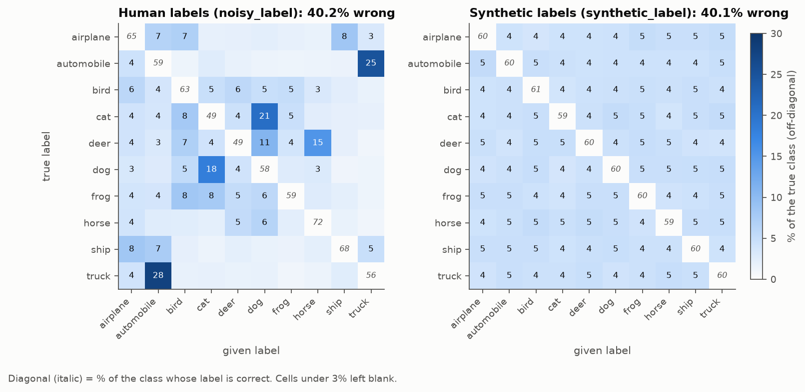
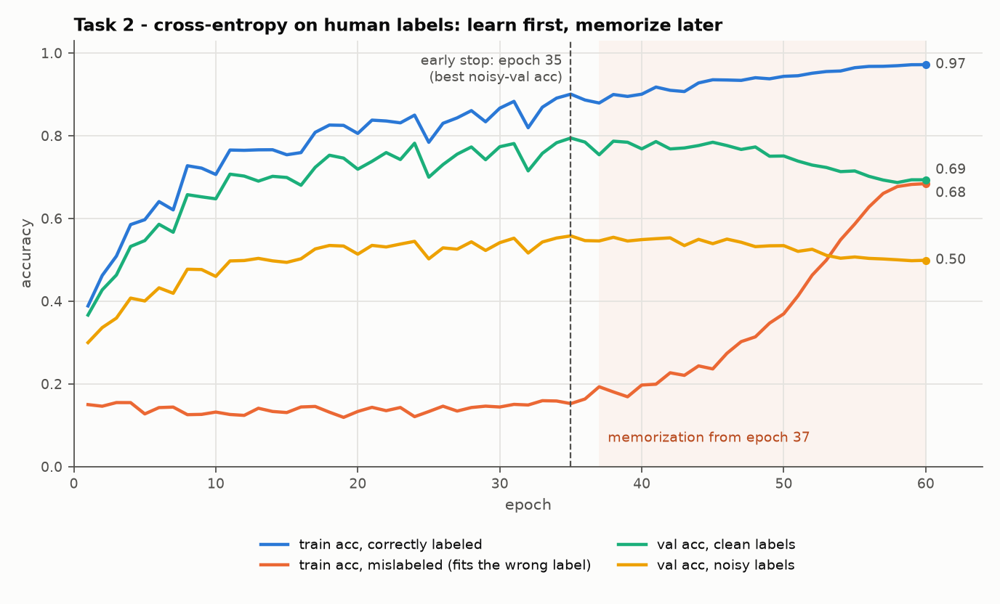
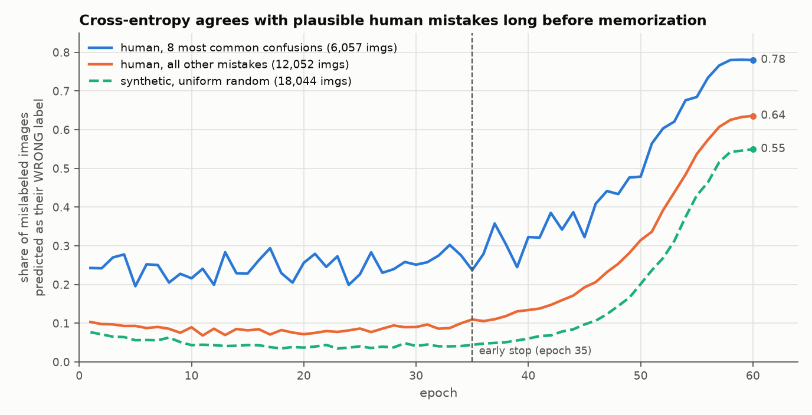
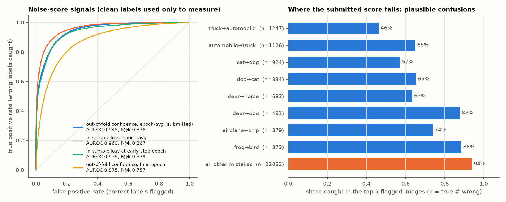
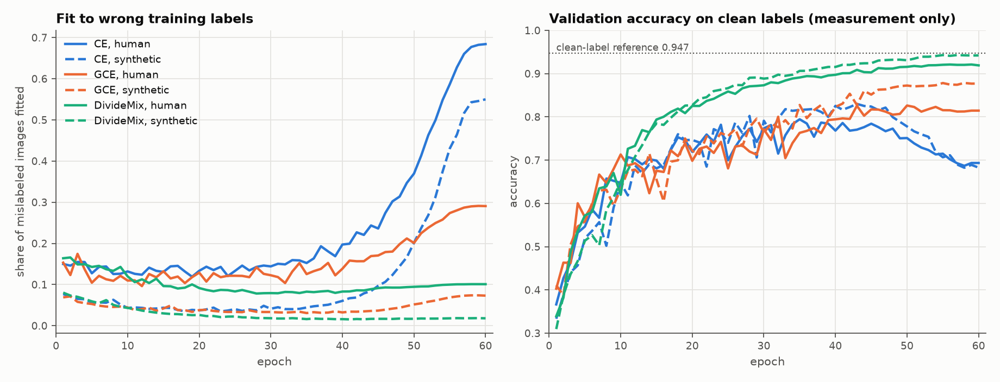
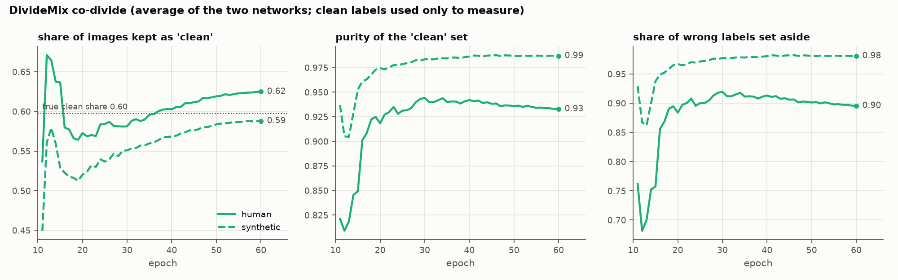

# What 40% wrong labels do to a ResNet-18, and how to undo most of it

Jainam Rampuria · 25b2142 · CIFAR-10N "worst". Every number here comes from `figures/analysis_numbers.json` or a run log, and every figure is produced by `python analysis.py`. Clean labels appear only as a measuring stick (as the rules allow); nothing in this file fed back into training or model selection.

## Results at a glance

Accuracy on the 5,000 validation images. *Noisy-val* is what I could use for decisions. *Clean-val* is measured with the true labels and used for nothing except this table.

| Model (selected epoch) | Noisy-val | Clean-val |
|---|---|---|
| Cross-entropy, final epoch (Task 1) | 0.499 | 0.693 |
| Cross-entropy, early stop @35 (Task 2) | 0.558 | 0.794 |
| Relabel with Task 3 scores @53 *(trained, not submitted)* | 0.566 | 0.822 |
| Filter with Task 3 scores @52 | 0.572 | 0.832 |
| GCE, q = 0.7 @51 | 0.572 | 0.823 |
| **DivideMix @55 (best)** | **0.593** | **0.920** |
| *Reference: cross-entropy on clean labels* | *0.592* | *0.947* |

With the same network and budget, DivideMix closes **89% of the gap** between training on noisy labels (0.693) and training on clean labels (0.947).

One thing surprised me: the clean-label reference scores only **0.592 on noisy validation**. A perfect model would agree with the noisy validation labels only about 60% of the time, because about 40% of them are wrong. So noisy-val saturates near 0.59, and DivideMix (0.593) is already at that ceiling. It also means noisy-val can't separate methods that are close. Its standard error is about ±0.007 (5,000 images at p ≈ 0.59), and GCE versus filter (0.5724 vs 0.5722) differ by a single image. I report their ranking because the task requires it, but I don't read anything into it.

## 1. The noise is structured, not random

Both label sets are about 40% wrong, but in completely different ways. Synthetic errors spread evenly (4–5% into every other class). Human errors pile into a few cells: 28% of trucks are labeled automobile, 25% of automobiles are labeled truck, 21% of cats are labeled dog, 15% of deer are labeled horse. The 8 most common confusions make up **33%** of all human errors, versus 10% for synthetic. Annotators confuse classes that look alike: vehicles, four-legged animals, and things with sky or water behind them. Cat and deer are the hardest classes (51% wrong), horse the easiest (28%).

## 2. Learn first, memorize later (Task 2)

The orange curve is the share of mislabeled training images the network predicts as their *wrong* label. For 36 epochs it stays flat at 12–16%, while accuracy on correctly labeled images climbs to 0.90. The network learns what a cat looks like and overrules wrong labels instead of fitting them. From **epoch 37** it starts memorizing: the curve rises to 0.68 by epoch 60, and clean-val accuracy falls from 0.79 to 0.69.

The timing follows from the learning-rate schedule. With cosine decay the step size gets small in the second half of training, and small steps let the network carve out exceptions for individual images, which is what memorization is. Early stopping on *noisy* validation picked epoch 35. That was exactly the epoch with the best *clean* validation accuracy (0.794), so noisy labels are good enough to choose *when* to stop, even though they can't rank close methods.

## 3. Some human noise is not memorized; it is learned

I expected wrong labels to be fitted only during memorization. That is true for synthetic noise (green, dashed): before epoch 35 the network agrees with only 4–6% of those errors. It isn't true for the 8 most common human confusions (blue). From epoch 1 the network already predicts 20–30% of them as their wrong label, *before any memorization*. Many of those images really are ambiguous, such as a pickup truck labeled "automobile" or a small dog labeled "cat", and the network makes the same call the annotator made.

I think this is the key difference between human and synthetic noise, and it shows up again in every later section. Part of human noise isn't noise from the model's point of view: it is consistent with the image.

## 4. Finding the wrong labels (Task 3)

I used 5-fold cross-validation (exactly the 5 allowed runs). Each image is scored by a model that never trained on it, so the score can't come from memorizing that image: score = 1 − p(given label), averaged over all 60 epochs. I fixed this before looking at any check. It gives **AUROC 0.945** and **precision@k 0.838** (k = 18,109, the true number of wrong labels).

What the check taught me:
* **Averaging over epochs matters most.** The same out-of-fold model at its final epoch alone gives only 0.875. By the end of training, each fold model has memorized its own noisy labels, so it confidently repeats the same confusions on the images it held out. The useful signal comes from the long phase before memorization.
* **The in-sample loss averaged over epochs did slightly better (0.960).** That surprised me: I expected in-sample signals to suffer from memorization. But averaged over the whole run, an image's loss mostly reflects the long early phase, before memorization. I did not switch my submission to it, because picking a signal after measuring it with clean labels would be selecting with clean labels.
* **Failure mode: plausible confusions.** 94% of rare errors are caught, but only 46% of truck→automobile and 57% of cat→dog errors. **75% of the wrong labels I miss come from just 8 pairs.** The flip side is false alarms on hard but correctly labeled images: 24% of correctly labeled cats and 21% of correctly labeled deer get flagged, against 3% of automobiles. The score really measures *how surprising the label is to the model*, which is not quite the same as *whether the label is wrong*.

## 5. Robust training (Task 4)

* **GCE (generalized cross-entropy, q = 0.7)** gives less gradient to images the model is confident disagree with their label. Wrong labels are fitted much more slowly (29% at epoch 60, versus 68% for cross-entropy), so the network rarely needs early stopping: noisy-val is 0.571 at the end and 0.572 at its best.
* **Filter** retrains on the 25,311 images that Task 3 did not flag, and **relabel** gives the flagged ones the out-of-fold prediction. Both depend on Task 3: the removed set is 81% truly wrong, and only 67.5% of the changed labels become correct. Filter also discards about 3,800 correctly labeled images. Both beat cross-entropy (0.83 and 0.82 clean-val) but run into the same ceiling: the plausible confusions Task 3 misses are still in the training set.
* **DivideMix** is the best method by a clear margin.

DivideMix fixes what filter can't. It re-divides the data *every epoch* using the current networks, and it keeps using the "noisy" images through their pixels instead of throwing them away. Each of the two networks fits a 2-component Gaussian mixture to its per-image losses: the low-loss component is "clean" and keeps its labels; the rest becomes unlabeled. Each network then trains on the split made by its *peer*, so a mistake one network has learned doesn't certify itself. On top of that come label refinement (clean labels are blended with the network's own prediction), co-guessing (labels for the unlabeled set are averaged from both networks), and MixUp.

The diagnostic I logged (clean labels, measurement only) shows the split working. The "clean" set ends up **93% correct** and sets aside **90% of wrong labels**. That is slightly better than my Task 3 filter (about 91% and 88%), without spending any extra runs on it. Only 10% of wrong labels are fitted at epoch 60. DivideMix keeps about 62% of images as clean against a true clean share of 60%, so it admits a few errors. Those are probably the same plausible confusions as in section 3.

## 6. Real vs synthetic noise (Task 5)

| Clean-val at selected epoch | Cross-entropy | GCE | DivideMix |
|---|---|---|---|
| Human noise (40.2%) | 0.794 | 0.823 | 0.920 |
| Synthetic noise (40.1%) | 0.825 | 0.877 | 0.942 |

The ranking doesn't change, but **every method does better on synthetic noise at the same noise rate**, and the robust methods benefit most. On synthetic labels, the DivideMix split is 98.7% pure and catches 98% of the errors (figure 6, dashed lines). GCE fits only 7% of the wrong labels (29% on human noise). A random label like "cat → truck" contradicts the image, so it stands out as a high-loss outlier. A human error like "truck → automobile" agrees with much of the image, so it hides among the clean images.

Cross-entropy without early stopping is the exception: it ends equally bad on both (0.693 vs 0.683). Given enough epochs, memorization fits whatever labels it is given.

My takeaway: **benchmarks with synthetic, symmetric noise overstate how well these methods work on real annotation noise.** The hard part of real noise is the part that looks right.

## 7. Limitations and what I would try next

* **One seed per configuration.** The budget rules out repeats. Differences under about 1.5 points of noisy-val (two standard errors) shouldn't be over-read.
* **Model selection is weak near the top**, because noisy-val saturates around 0.59 (see above). Holding out validation data with a cleaner label signal isn't allowed here, so I relied on the clean-val numbers only to *understand* the results, never to choose.
* **Next steps within the rules:** (1) DivideMix with an active unlabeled loss (`--lambda_u > 0`) or a per-class GMM threshold, since a single global loss threshold is exactly what plausible confusions slip under. (2) Use the class-pair structure from Task 1 directly: estimate the noise-transition matrix from out-of-fold predictions and correct the loss with it (forward correction), which targets systematic confusions specifically. (3) For Task 3, combine the out-of-fold signal with per-class-normalised scores, so naturally hard classes like cat and deer aren't over-flagged.

## Engineering notes

* `train.py` saves the softmax on all 45k training images and the val/test logits *every epoch*. Task 2 curves, early-stop predictions and Task 3 signals then need no retraining, and any epoch can be exported later.
* My first two DivideMix launches died in the built-in smoke test (3 tiny epochs on a few thousand images) before any real training: after only a few dozen updates the BatchNorm running statistics are still wrong, and fp16 logits overflowed into NaN. Clamping non-finite logits and skipping non-finite steps fixed it. The real runs skipped 0 steps. Having the smoke test meant a 2-minute failure instead of a 2.5-hour one.
